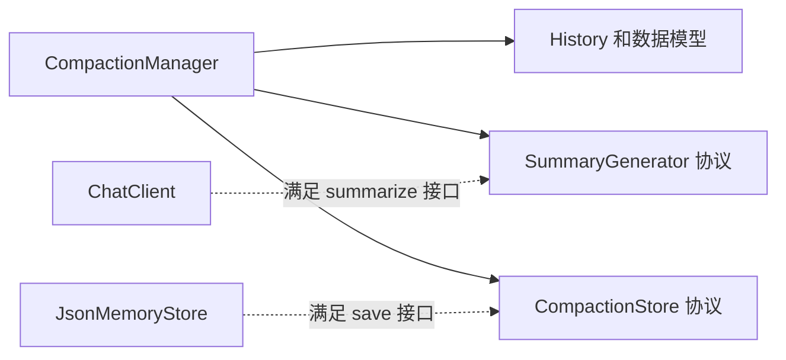

# 代码检查修复助手

使用 Python 3.10+，通过 `python-dotenv` 加载 `backend/.env`。
当前执行器需要 Linux 等支持 `fork` 的系统。

## 项目目录

后端源码集中在 `backend/`，前端位于 `frontend/`，通过本机 API 管理对话、任务、分支和工具审批。
Web 和 CLI 复用同一个 Agent 执行循环与历史存储；项目写入锁保证两个入口不同时修改同一项目。
以下说明中的 Python 模块名均指 `backend/` 中的对应模块。

```text
项目根目录/
├── backend/
│   ├── __init__.py
│   ├── main.py                # CLI 模块入口
│   ├── web_main.py            # 本地 Web 模块入口
│   ├── .env                   # 模型配置，内容沿用原文件
│   ├── paths.py               # 项目、配置、历史和前端路径
│   ├── agent_factory.py       # CLI/Web 共用组装入口
│   ├── runtime_lock.py        # 项目写入互斥
│   ├── agent.py / cli.py
│   ├── models.py / history.py / memory_store.py
│   ├── persistent_memory_management.py  # 全局持久记忆缓存与管理
│   ├── llm.py / model_api.py / prompts.py
│   ├── runner.py / message_utils.py / token_stats.py
│   ├── context_manager.py / compaction.py
│   ├── api/                   # 路由、快照转换、进程与审批适配
│   └── tools/                 # 原有文件、搜索和 MCP 工具
├── frontend/                  # HTML、CSS、JavaScript 和本地 SVG
├── tests/                     # 原有三个测试模块
├── memory/                    # 原有历史，位置保持不变
├── test.py                    # 原有调试脚本
├── error.py                   # 原有待检查样例
└── requirements.txt
```

`backend.paths` 统一定义路径：配置位于 `backend/.env`，历史位于根目录 `memory/`，
CLI 文件工具根目录仍为项目根目录。模块采用包内相对导入，两个入口同时支持直接运行文件和从项目根目录以模块方式启动。

## Python 环境与 Debug

使用项目 `.venv` 的解释器安装依赖和运行，避免系统 Python 与虚拟环境混用：

```bash
.venv/bin/python -m pip install -r requirements.txt
.venv/bin/python -m backend.main
```

运行 `backend.main` 模块，在终端选择对话和分支后输入自己的任务，无需配置任务参数。
VS Code 中也可以选择“Debug 代码检查助手（项目虚拟环境）”配置，按 F5 后操作终端菜单。
该配置显式使用 `.venv/bin/python`、`module: backend.main` 和项目根工作目录，并使用集成终端接收代码执行确认。
调试测试时打开 `tests/test_*.py`，选择“Debug Current Test”，按 `tests.<文件名>` 模块启动。
普通运行时也应通过“Python: Select Interpreter”选择项目虚拟环境。
PyCharm 中将解释器设为项目 `.venv/bin/python`，运行配置使用模块名 `backend.main`，工作目录设为项目根目录。
也可以打开 `backend/main.py`，点击“在终端中运行 Python 文件”；入口会根据自身文件位置补齐包路径，不依赖终端当前目录。

终端入口自动启用标准库 `readline` 的行编辑，处理中文退格和光标移动；不额外保存输入历史。
Debug 时使用集成终端，IDE 的调试控制台未必支持同样的终端编辑行为。

## 本地 Web 工作台

在项目根目录运行：

```bash
.venv/bin/python -m pip install -r requirements.txt
.venv/bin/python -m backend.web_main
```

浏览器打开 `http://127.0.0.1:8888`；也可以直接运行 `backend/web_main.py`，或在 VS Code 选择“Debug Web 工作台”后按 F5。
CLI 继续使用 `.venv/bin/python -m backend.main`。Web 新增 Flask 作为 HTTP 依赖，前端无需 Node、构建工具、TypeScript 或 CDN。

界面支持新建/加载对话、提交任务、原始消息、工具代码与结果、逐次审批、分支切换和创建、检查点恢复、Token 用量及累计摘要。
三栏工作台支持明暗主题、独立收起左右面板；窄屏通过抽屉查看导航与详情。支持 Ctrl/Cmd+K 搜索、最新消息定位及摘要覆盖边界跳转。

外观与布局：

- 首次访问跟随系统明暗主题；右上角太阳/月亮按钮直接切换。左下角工作空间或设置按钮打开“工作台偏好”，可选择浅色、深色或跟随系统，无需刷新。
- 主题与桌面面板折叠偏好仅保存在当前浏览器的 localStorage，不包含消息、审批或模型配置；存储不可用时仍可切换，刷新后回到系统主题。
- 桌面左栏约 248～256px、右栏约 300～312px，消息最大宽度 900px。右栏在 1180px 及以下改为抽屉，左栏在 760px 及以下改为抽屉，两侧均有显示/收起按钮。
- 抽屉支持 Escape 关闭和 Tab 焦点约束；关闭后归还入口焦点。Ctrl/Cmd+K 会展开必要的导航并聚焦搜索；偏好窗口提供“恢复默认布局”。
- 工具调用以可展开的执行记录展示，保留完整代码、调用 ID、结果状态和复制操作。审批区仍单独展示原始代码，只批准当前一次调用。
- 输入框随内容增高，Enter 换行、Ctrl/Cmd+Enter 发送。发送中仅表示正在提交请求，Agent 阶段继续依据真实后台状态展示。
- 配色统一由 styles.css 的 CSS Variables 管理，含代码、错误、状态、弹窗与明暗主题；尊重系统减少动态效果设置。前端仍为原生 HTML/CSS/JavaScript，无构建或新增 UI 依赖。

使用流程：

- 新建对话会保存系统根节点，首条任务自动生成标题。在输入框描述任务后发送，或按 Ctrl/Cmd+Enter；Enter 换行。
- 用户消息和 running 检查点保存成功后，提交接口返回任务 ID。后台执行不阻塞 HTTP；刷新或关闭浏览器不会重复提交，也不会默认批准。
- 模型申请工具调用时显示完整、只读的 Python 代码。批准仅作用于该次调用，多调用逐条确认；取消沿用 Agent 的取消语义，保留此前的实际文件修改。
- 空闲时选择分支会保存 current_leaf_id；执行或等待审批时只能预览其他分支，不改变实际执行路径。点击“查看正在执行的任务”可返回审批所在位置。
- 消息旁的“从这里继续”只选择父节点；提交新任务时才创建分支。原节点与原分支保留，项目文件不会恢复到旧版本。
- 后台不在执行时，未完成任务提供恢复/结束操作；executing_tool 或 needs_review 必须先确认旧进程停止并记录实际核对结果。核对说明属于原任务，不创建另一条 TaskRun。
- Token 面板区分当前上下文估算与最近一次请求的 API usage。“用于当前预览”的摘要来自读取视图，“最近请求使用”来自实际请求记录，二者不混用。
- 执行状态按约 1 秒轮询，空闲时约 5 秒，隐藏页面暂停；ETag 避免重复传输。配置改变后需重启 Web 服务。

执行服务与兼容边界：

- Web 启动一个非 daemon 的 spawn 进程，内部单线程运行现有 Agent；HTTP 进程通过 Pipe 传命令和观测事件。审批回调等待用户决定后仍返回 True/False，不重建任务或重置当前轮数预算。
- 全局同一时刻执行一条任务，包括等待审批阶段。项目锁由后台进程持有；开启 Web 写入服务时 CLI 会提示项目被占用，关闭 Web 后即可启动 CLI。
- 若其他 CLI/Web 已持有锁，新 Web 入口退为浏览模式；停止原入口后需重启 Web 才能获得执行能力。独立 `create_app()` 不注入服务时也保持只读能力。
- 关闭服务会尽力中断任务并保留检查点；强杀、超时或未知副作用仍需人工核对，不提供跨文件事务、自动回滚或恰好一次执行保证。
- 新建、浏览、核对和结束任务不需要请求模型；执行任务使用原 backend/.env 配置。模型配置错误会报告原因；执行前配置无效时请求可直接被拒绝，已开始的任务则保留检查点。
- 运行期 usage、进程状态和请求去重记录保存在内存；服务重启后不补造历史实测值。旧审批失效，恢复任务后会重新请求批准。
- 写操作校验完整历史版本，GET 仍不保存历史或触发摘要。检测到历史被外部程序改变时拒绝覆盖；不支持绕开写入锁并发修改历史文件。

| 只读接口 | 返回内容 |
| --- | --- |
| `GET /api/info` | 浏览模式、可用能力与上下文配置状态，不返回模型密钥 |
| `GET /api/session` | 当前浏览器的 CSRF 凭证，通过 HttpOnly / SameSite Cookie 关联 |
| `GET /api/conversations` | 对话元数据、更新时间及无法加载的文件提示 |
| `GET /api/conversations/<id>` | 默认分支消息、分支列表、相关任务、统计及摘要 |
| `GET /api/conversations/<id>?leaf_id=<leaf>` | 其他叶节点的只读快照 |

以下写接口都要求 JSON 和 X-CSRF-Token，并携带唯一 client_request_id；已有会话操作还要携带 expected_revision（完整历史版本）。
提交、恢复、审批返回 202 表示操作已接收，不代表任务完成；状态以之后的检查点为准。相同请求 ID 与参数在当前服务运行期去重，过期版本或审批返回 409，前端不盲目重发。

前端优先使用 `crypto.randomUUID()` 生成请求 ID；浏览器未提供该方法时（例如非本机 HTTP 页面），
使用 `crypto.getRandomValues()` 生成 UUID，避免在请求发出前报错。此兼容不替代 HTTPS 或访问认证。
“操作结果尚未确认”仅用于写请求的网络失败；页面代码错误与读取失败会单独报告。
结果未知的写请求仍在当前页面内保留原请求 ID 和参数，重试时不生成新的 ID。

| 写接口 | 业务输入 |
| --- | --- |
| `POST /api/conversations` | 创建空对话 |
| `POST /api/conversations/<id>/branches/select` | leaf_id |
| `POST /api/conversations/<id>/tasks` | text、可选 parent_id |
| `POST /api/conversations/<id>/tasks/<task>/approval` | approval_id、tool_call_id、decision（approve/reject） |
| `POST /api/conversations/<id>/tasks/<task>/resume` | confirmed_stopped=true |
| `POST /api/conversations/<id>/tasks/<task>/review` | confirmed_stopped=true、note |
| `POST /api/conversations/<id>/tasks/<task>/cancel` | 结束原任务，未知副作用需先核对 |

`backend/api/app.py` 负责 HTTP、请求校验和静态资源白名单；`serializers.py` 负责页面快照；
`service.py` 管理后台进程、请求去重和运行观测；`worker.py` 串行调用现有 Agent，并将用户决定交给审批回调。
保存成功后才发布观测事件，通知失败不伪装成保存失败。文件快照与运行事件以历史版本核对，避免旧消息与新空闲状态混在一起。
前端 `app.js` 只提交用户意图和展示结果，使用 textContent 安全渲染历史文字，不能提交替换工具代码或直接调用 runner。
Web 入口关闭调试器和自动重载；检查 Host/Origin 和 CSRF，不开放跨域或项目目录。
开发服务仅用于本机使用，未提供公网部署或用户认证功能。

## 全局持久化记忆

启动方式保持不变：运行 `backend/web_main.py`，或在根目录执行 `.venv/bin/python -m backend.web_main`，
浏览器打开 `http://127.0.0.1:8888`。左侧“新建对话”和搜索框之间增加“记忆管理”，点击后切换到独立页面，
可返回原聊天；会话、分支和未发送的聊天草稿保持。

- 点击“新建记忆”创建一条未应用的空记忆；选中列表项只进入编辑，不切换当前应用。
- 名称和正文支持编辑，正文为 Markdown 文本；“保存”同步后端。“应用”仅应用已保存内容。
- 当前应用在列表和页面顶部标识；“取消当前应用”停止后续注入。删除当前记忆也会清空应用状态，不自动选择另一条。
- 所有会话共享一条当前记忆。任务执行或等待审批时仍可编辑和切换，已生成的工具代码及审批凭证不变。
- 保存和应用从下一次模型请求的准备阶段生效；已发出的请求不会撤回，恢复任务也使用当前应用记忆。
- 有未保存修改时，切换条目或返回聊天会确认是否放弃；保存冲突保留草稿，可重新加载后核对。

`PersistentMemoryManager` 在入口创建，启动时通过 `PersistentMemoryStore` 加载
`memory/long_term/memories.json`，文件包含 `version`、`revision`、`active_memory_id` 和 `memories`。
首次没有文件时视为空目录，第一次修改时创建；该运行数据目录已加入 Git 忽略。
名称最多 120 字符，正文最多 32000 字符，最多 100 条，目录文件最大 2 MB。

管理器以 RLock 串行修改，保存到同目录临时文件并 fsync 后原子替换，保存成功才发布新缓存。
记忆文件单独使用写锁与文件签名校验，检测到其他实例或外部程序修改时拒绝覆盖。修订号防止过期编辑覆盖，
client_request_id 在当前管理器生命周期内去重；去重结果不跨进程重启保存。
第一版仅支持单个可写 Web 进程，不提供多 WSGI worker 的缓存同步或运行中手动编辑 JSON 的热加载。

Web 父进程持有管理器，Worker 通过现有 Pipe 同步获取内存快照；正常模型请求不重读 JSON，
Worker 保持单线程。记忆 CRUD 不进入 Agent 写命令队列，不会因模型执行或等待审批而阻塞。
CLI 启动时加载同一目录并使用本地管理器，不逐任务询问。

模型输入在历史视图构造完成后追加一条临时 USER 消息，content 为
`{"context_type":"long_term_memory","name":"记忆名称","content":"Markdown 正文"}`。
固定系统规则说明它是用户背景资料、不是新任务，不单独回答，也不能覆盖系统规则或工具权限。
规则附加到临时系统消息副本，所以旧对话也生效；原始系统根节点不修改。
记忆不创建 Session 或 TaskRun，不保存到对话 JSON，不交给历史摘要器。
模型此前已经把记忆内容写入回答时，这些实际历史仍保留，取消应用不会自动抹除。

ContextManager 在注入后估算完整 Token 和 fingerprint，一次预检和压缩前后固定同一快照；
每次实际请求尝试前检查更新，普通重试也能使用新记忆。超限时只压缩安全旧历史，
记忆和当前任务仍放不下就暂停并报告。页面预览估算包括当前记忆，最近请求的 usage 与记忆 ID/修订号属于实际请求观测。
记忆始终在临时列表末尾，每轮重新构造且只追加一份；这种位置可能减少多轮前缀缓存复用。

| 接口 | 输入 |
| --- | --- |
| `GET /api/memories` | 返回全部条目、active_memory_id、revision 和 writable |
| `POST /api/memories` | name、content |
| `PUT /api/memories/<id>` | name、content |
| `DELETE /api/memories/<id>` | 无业务字段 |
| `POST /api/memories/active` | memory_id；null 表示取消应用 |

所有写接口还要求 `client_request_id`、`expected_memory_revision`、JSON 正文与 `X-CSRF-Token`，
PUT/DELETE 同样校验 Host、Origin 和 CSRF。记忆修订冲突返回 409；只读 Web 不允许修改。
前端不会直接读写 JSON。修改记忆只影响上下文预览修订，不改变会话 history_revision，因此不会使原工具审批失效。

验证：`.venv/bin/python -B -m unittest tests.test_persistent_memory -v`。
覆盖磁盘恢复、当前条目选择、历史不变、无重复注入、Token/指纹、压缩和强制恢复、重试时切换、
原子保存失败、并发冲突、接口校验，以及真实 Worker/审批/本地 runner 的多轮闭环；模型使用替身。

## 启动 Agent（模型配置）

接口地址可填完整的 POST 地址；若只填域名或以 `/v1` 结尾的基础地址，程序会自动补成
`/v1/chat/completions`。其他自定义路径保持原样。当前协议为 Chat Completions
兼容格式，服务需支持 `tools` 函数调用；仅修改 URL 不能适配完全不同的请求协议。

```bash
export MODEL_API_URL='https://your-provider.example/v1/chat/completions'
export MODEL_NAME='your-model'
# 交互读取密钥，避免将真实密钥写入 shell 历史或源码。
read -rsp 'API Key: ' MODEL_API_KEY
export MODEL_API_KEY

.venv/bin/python -m backend.main
```

配置项：

| 环境变量 | 用途 | 默认值 |
| --- | --- | --- |
| `MODEL_API_URL` | 完整接口地址或常见基础地址 | 必填 |
| `MODEL_NAME` | 模型名称 | 必填 |
| `MODEL_API_KEY` | 认证值；本地免认证服务可不设置 | 空 |
| `MODEL_AUTH_HEADER` | 认证请求头名称 | `Authorization` |
| `MODEL_AUTH_PREFIX` | 认证值前缀，注意末尾空格 | `Bearer ` |
| `MODEL_EXTRA_HEADERS` | 额外请求头，JSON 字符串 | `{}` |
| `MODEL_TIMEOUT` | 单次 API 请求超时秒数 | `60` |
| `MODEL_CONTEXT_WINDOW` | 实际模型/服务的总上下文 token 上限 | 必填，不猜测 |
| `MODEL_MAX_OUTPUT_TOKENS` | 每次主请求允许生成的 token 上限，作为 `max_tokens` 发送 | 必填，需在服务支持范围内 |
| `MODEL_CONTEXT_RESERVE_RATIO` | 窗口最低预留比例 | `0.2` |
| `MODEL_TOKEN_SAFETY_MARGIN` | 输出上限之外的安全余量 | `512` |
| `MODEL_TOKENS_PER_CHAR` | Unicode/JSON 字符的 token 粗估系数 | `2` |
| `MODEL_SUMMARY_MAX_TOKENS` | 无工具摘要请求的输出上限 | `min(1024, 主请求输出上限)` |

启用窗口控制后，需要自行在 `backend/.env` 或进程环境中补充窗口和输出上限；缺失时启动会报告具体变量。
窗口填实际服务规格，输出上限填自己允许的生成预算。程序不会替你修改 `.env` 或猜测模型能力。
token 数量支持整数及 K/M 单位（大小写均可）：`272K = 272000`，`128K = 128000`，`1M = 1000000`；
预留比例填写 `0.2`，不填写 `20%`。配置无效时会指出具体变量或没有输入空间的预算。

例如服务使用 `api-key: <密钥>` 而非 Bearer 认证：

```bash
export MODEL_AUTH_HEADER='api-key'
export MODEL_AUTH_PREFIX=''
```

其他 token 也可以放在 `MODEL_API_KEY` 中，通过上述两个配置控制发送方式。
多个认证字段可用 `MODEL_EXTRA_HEADERS` 提供；与认证字段重名时，以单独配置的认证值为准。
程序通过 `backend.paths.ENV_FILE` 自动加载 `backend/.env`，不依赖当前工作目录；已存在的进程环境变量优先，
不会被 `.env` 覆盖。不要将包含真实密钥的 `.env` 提交到版本库。
服务若有不同的消息或工具调用协议，应修改 `llm.py` 的适配逻辑。

每段模型生成代码都会展示并询问确认，只有输入 `y` 才执行。
运行配置直接在 `backend/main.py` 的 `main()` 中修改：`root` 是文件工具根目录，
默认为项目目录；`max_rounds = 10` 控制本次执行最多的模型决策轮数，每轮请求最多尝试 3 次，
`code_timeout = 5.0` 控制每次代码执行超时。不再解析命令行参数。
达到上限或 API 重试耗尽时，任务保留检查点，终端可选择恢复、明确结束或返回列表；配置错误保存检查点后退出并报告。拒绝代码执行会取消该任务。不会自动重放已执行代码。

## 终端对话和分支菜单

```text
启动 → 我的对话 → 新建或加载 → 选择分支
                               ↓
                      回车沿用当前 / 编号切换
                               ↓
                       输入任务 → Agent.run
                               ↓
                       保存 → 继续输入或返回
```

`cli.py` 负责菜单和连续输入，不调用模型选择对话或分支：

- 扫描 `memory/*.json`，校验后按更新时间倒序展示标题和更新时间，时间按北京时间显示。
- 新对话首次输入任务后保存，标题取首条用户任务的简短摘要，不额外调用模型生成标题。
- 旧文件没有 title 字段时，从首条用户消息恢复标题，读取操作本身不覆盖旧文件。
- 选择旧对话后按 Conversation.id 重新加载文件，默认分支来自保存的 current_leaf_id。
- 分支列表每项对应一个叶节点，展示其路径中的最后一条用户消息、最后一条助手消息和最后消息时间；“当前”表示已选分支。
- 回车沿用当前分支，编号选择其他叶节点后立即保存，因此下次打开仍沿用该选择。
- 有任务检查点的未结束分支标记为“任务待恢复”或“结果待核对”，打开后显式选择恢复。没有检查点、消息又不完整的旧分支仍标记为“暂不可继续”。
- 读取失败或校验失败的历史文件单独提示并跳过，不影响其他对话。

| 输入位置 | 输入 | 行为 |
| --- | --- | --- |
| 对话列表 | 对应编号 | 加载旧对话或创建新对话 |
| 对话列表 | `0` | 退出程序 |
| 分支列表 | 回车 | 沿用当前分支 |
| 分支列表 | 对应编号 | 切换并保存叶节点选择 |
| 分支列表 | `0` | 返回对话列表 |
| 任务输入 | 普通文本 | 提交任务，随后可连续输入下一条 |
| 任务输入 | `/fork` | 选择当前分支中的旧消息，在它后面继续 |
| 任务输入 | `/branches` | 打开当前对话的分支列表 |
| 任务输入 | `/back` | 返回对话列表 |
| 任务输入 | `/quit` | 退出程序 |

恢复的模型上下文为“保存的系统消息 → 当前分支的有效累计摘要（如有）→ 未压缩的历史和当前任务”，不会把其他分支拼到系统提示词中。
使用 `/fork` 可从当前分支中的旧节点创建新分支；需要从其他分支的消息开始时，先通过 `/branches` 切换到该分支。
任务提交与人工审批可使用 CLI 或 Web；两个入口共用项目写入锁，使用同一套领域逻辑和 JSON。

### 从旧消息创建分支

1. 在任务输入处输入 `/fork`。
2. 按编号选择当前分支的一条消息，列表显示角色和摘要；工具调用尚未完整配对的位置标记为不可继续。
3. 查看选中消息的完整内容，确认新任务要接在它后面。
4. 输入新任务，程序调用 `agent.run(task, history=history, parent_id=selected_id)`。
5. 新用户节点的 parent_id 指向选中节点，current_leaf_id 更新为新节点；保存后请求模型，后续消息沿新路径继续。

选择菜单输入 `0` 或回车可取消；预览后留空或输入 `/cancel` 也可取消。取消不创建节点，不改变当前叶节点，不写入文件，也不调用模型。
选中已有后续消息的旧节点会创建分叉，并保留原分支；选中当前叶节点只是普通追加。
这项操作是在选中消息后继续，不会修改选中消息或替换它原有的回答。

创建分支前不会把 current_leaf_id 改成中间节点，只有提交有效任务后才由 History.append() 更新为新节点 ID。
模型收到的是“根 → 选中消息 → 新任务”的路径，原分支中位于选中消息之后的内容不会发送。
分支只改变聊天上下文，沿用当前项目文件，不恢复历史文件版本。

## 执行循环

`main.py` 通过 `agent_factory.py` 组装工具、接口和上下文管理 → `cli.py` 接收终端任务 → `agent.py` 维护检查点 → `ContextManager` 准备上下文 → `llm.py` 请求模型。
Web 则由 HTTP → AgentService → 独立 Worker 调用相同 Agent，工具审批通过 Pipe 回到原调用栈。
模型调用 `run_code` 时，宿主先确认代码，再调用 `runner.py`，将状态、输出和异常
记录为带 `tool_call_id` 的工具消息，连同历史发送到下一轮。
模型返回没有工具调用的普通回答时结束，最终回答应包含原代码问题、修改和验证依据。

每条消息使用现有 `Session` 结构建立父子关系，`Conversation` 保存对话 ID、根节点、
当前叶节点及创建/更新时间。`agent.history_tree` 保留整棵历史树，`agent.history`
仅返回当前分支。每次 `agent.run()` 默认新建对话，也可以传入已有历史继续。
长任务可能超过模型上下文窗口。当前非流式，不展示模型内部思考过程。
“完成”表示模型已给出最终回答，不代表独立评估已证明所有修复正确。
程序不会自动运行项目里的 `error.py`，也不会在启动时修改它。

## 历史持久化与分支

`history.py` 管理节点与分支，`memory_store.py` 负责 JSON 编解码和文件读写。
默认保存位置是项目目录下的 `memory/<conversation_id>.json`，不依赖启动工作目录。
每个文件包含 `schema_version`、`conversation` 元数据、全部 `nodes`、任务检查点 `tasks` 和独立压缩记录 `compactions`。旧文件没有 tasks/compactions 时按空列表加载，不编造历史执行阶段或摘要。
时间保存为带时区的 ISO 8601 字符串，角色保存为字符串，加载时恢复为对应 Python 类型。

Agent 追加用户消息、助手消息或工具结果后都会保存一次。保存前和加载后校验：
ID 唯一、唯一根节点、双向父子关系、全树连通无环，以及当前节点确实为叶节点。
使用临时文件写入、flush/fsync 后原子替换，写盘失败时停止当前执行。

当前仅支持单进程写入；没有并发锁、自动备份或断电后目录元数据持久化保证。

以下示例是终端菜单所使用的底层接口，假设你已创建 `agent`：

```python
# 新建对话：自动保存。
result = agent.run(task)
conversation_id = agent.history_tree.conversation.id

# 继续当前分支：也可将 loaded 传给另一个新创建的 Agent。
loaded = agent.store.load(conversation_id)
result = agent.run(next_task, history=loaded)

# 从历史中的完整节点创建新分支，旧分支保留。
result = agent.run(branch_task, history=loaded, parent_id=earlier_node_id)

# 切换回已有分支并保存选择。
loaded.select_leaf(other_leaf_id)
agent.store.save(loaded)
```

`History.append(message, parent_id=...)` 也可以直接创建分支。
当前上下文通过根到当前节点的祖先链构造，不会混入其他分支。
再次调用 `agent.run()` 时必须显式传 `history` 才会继续，不会自动加载最近对话。
终端菜单在选择旧对话和连续输入时会显式传入 history；只有用户选择“创建新对话”才新建历史树。

恢复时沿用保存的系统提示词，因此应提供与原对话相符的工具配置。
普通新任务仍要求父节点前的工具调用与结果完整。已有任务通过专门的恢复入口处理待确认或结果未知的调用，不会直接重放。
没有任务检查点的旧分支若存在未配对调用，无法可靠推断工具是否开始，仍拒绝自动恢复。
创建分支只改变聊天历史，不会恢复或回滚项目文件。
历史始终保存完整消息和工具结果，尚未实现脱敏或加密。压缩只改变模型可见视图，已由窗口管理接入 Agent。

## 任务检查点与中断恢复

每次提交新任务时创建 `TaskRun`，通过 `user_node_id` 关联原始用户消息。
它记录独立任务 ID、最后保存的节点 `checkpoint_node_id`、状态、阶段、活动工具调用 ID、累计模型请求尝试次数、错误和时间。
同一 Conversation 可保存多个任务记录，不把整段对话简单标记为一个执行中任务。

| 状态 | 含义 |
| --- | --- |
| `running` | 任务执行中，或上次进程未正常结束；单凭该字段不能判断进程是否还活着 |
| `interrupted` | 请求失败或捕获到中断，可从阶段检查点继续 |
| `needs_review` | 工具结果不确定，先核对进程和副作用 |
| `limit` | 本次模型轮数预算用尽，可显式恢复 |
| `completed` | 最终回答和完成状态已保存，表示执行循环结束，不代表修复一定正确 |
| `cancelled` | 用户明确结束任务，已经产生的修改保留 |

检查点按以下顺序提交：

```text
用户任务 + running / waiting_model 一起保存
→ 请求模型（请求尝试次数先保存）
→ 助手工具请求 + waiting_approval 一起保存
→ 人工确认
→ executing_tool + active_tool_call_id 先保存
→ run_code
→ 工具结果 + 下一阶段一起保存
→ 继续请求模型
→ 最终回答 + completed / finished 一起保存
```

由 `Agent._checkpoint()` 统一写一份 JSON 快照，避免回答已写入却单独丢失完成标记，或完成标记先于最终回答写入。
保存失败会停止，不尝试把内存中的未提交状态再补写一次；后续必须重新加载磁盘历史。

打开待恢复分支后，终端展示原任务、阶段和累计轮数，提供“恢复原任务”“结束原任务”“返回列表”：

| 保存阶段 | 恢复行为 |
| --- | --- |
| `waiting_model` | 用现有上下文重新请求模型；上次请求可能已到达服务端，可能重复计费 |
| `waiting_approval` | 重新展示尚未执行的代码并确认，跳过已经保存结果的调用 |
| `executing_tool` | 不能断定代码是否生效，暂停并要求核对，不直接重跑 |
| `finished` | 不重复执行已结束的任务 |

超时或工作进程没有返回结果也会暂停为 needs_review，而不是直接自动重试。
结果未知时，只有用户输入“已核对”，确认旧程序及工具子进程已停止，并记录实际文件/外部操作状态，才可继续。
核对后为缺失结果的原调用追加 `TOOL_OUTCOME_UNKNOWN`，为同批尚未开始的调用追加 `TOOL_NOT_STARTED`；这些是恢复说明，不是假造成功结果。
已有超时/未知结果不重复追加。另保存一条明确标记的人工恢复核对消息，让模型依据真实状态继续分析。
之后如模型提出新代码，仍需逐段人工确认。

底层接口示例，假设 agent 已创建：

```python
loaded = agent.store.load(conversation_id)
task = loaded.unfinished_task()
if task is not None:
    result = agent.resume(loaded, task.id)
    # needs_review 会停止在人工核对边界，不自动执行未知结果的代码。
```

恢复复用原 TaskRun，不重复追加原始 task。TaskRun.rounds 保存主模型请求的累计尝试次数，包含重试，不计摘要请求。
每次显式恢复最多再执行 max_rounds 个决策轮次，每轮最多尝试 3 次；摘要请求另有限次重试。
有未结束任务的同一检查点不接受另一条新任务，用户可先恢复或明确结束原任务。
本阶段支持单进程使用，不提供会话并发锁，不自动探测或终止旧进程。Ctrl+C 会尽力保存状态；强杀进程无法依赖 finally，工具子进程甚至衍生进程可能仍存活，恢复前必须核对。
不能把 TaskRun 的标记当作进程已经结束的证明。

JSON 原子替换只覆盖历史快照，不能使“修改项目文件或外部服务”和“保存历史”成为同一事务；没有恰好执行一次、自动回滚或从任意 Python 语句断点继续的保证。

## 最小用法

```python
from backend.tools import ToolRegistry, register_file_tools
from backend.prompts import build_system_message
from backend.runner import run_code
from backend.paths import PROJECT_ROOT

registry = ToolRegistry()
register_file_tools(registry, PROJECT_ROOT)
system_message = build_system_message(registry)
# 接入模型后，将 system_message 和历史消息一同发送给模型。
print(system_message.content)

# 当前手工模拟模型生成的代码；真实接入后也应先展示代码供人工检查。
code = 'text = read_file("backend/models.py")\nprint(text[:500])'
print(code)
# 仅在人工确认这段具体代码之后，由宿主程序设置 approved=True。
result = run_code(code, registry, approved=True)
print(result.status, result.output, result.error)
```

`approved` 是调用方对人工确认的声明，不是执行器自动完成审批。
不要允许模型设置它，也不要把 `run_code` 注入生成代码的工具列表。

## 工具组织

- `tools/base.py`：注册名称、函数和一句描述，自动提取参数及返回值签名。
- `tools/files.py`：读取、查看目录、写入；默认禁止覆盖，父目录需已存在。
- `tools/search.py`：注入同步搜索函数，真实服务由后续选择和配置。
- `tools/mcp.py`：注册已连接 MCP 工具的同步适配函数，参数签名需真实反映工具参数。
- `prompts.py`：只把已注册工具放入系统消息；注册变化后需重新构建消息。
- `runner.py`：独立进程执行，返回 `success`、`error`、`timeout` 或工作进程无结果时的 `unknown`。

搜索和 MCP 当前只有接入入口，没有真实服务连接。调用方负责认证、客户端生命周期、
外部请求超时，以及需要时把异步接口包装为同步函数。不要直接继承正在使用的网络连接；
此 fork 原型的适配函数应在子进程中创建自己的客户端。

## 执行边界

这是单线程、可信本地实验原型，不是安全沙箱。生成的 Python 具有当前用户权限，
可以绕过文件工具访问文件和网络。独立进程只隔离 Python 变量状态，不隔离系统权限。
父进程内存中的工具状态变化不会被子进程同步回来；文件等外部修改会保留。

文件工具拒绝解析后越出项目目录的路径，但不防御并发替换符号链接等竞态。
执行器截取 Python 标准输出和异常；底层文件描述符写入和衍生进程输出不在保证范围内。
超时终止直接工作进程，可能丢失此前输出，也不终止其衍生进程。
异常或超时不会回滚已写文件及外部副作用。不要对不可信代码使用此执行器。

`llm.py` 仅向模型 API 声明 `run_code` 一个工具；文件、搜索及 MCP 的签名通过
系统提示词提供，模型在生成的 Python 中组合调用它们。宿主的 `approved` 参数
不属于模型可传参数，不允许模型自行批准执行。

## Token 统计模块

`token_stats.py` 独立提供请求前的输入估算和响应后的 usage 解析，不导入 Agent、模型客户端或历史管理模块。
它不发送 API 请求、不改变上下文，也不判断窗口阈值或触发压缩。

```python
from backend.token_stats import estimate_request_tokens, parse_usage

# 使用实际准备发给 API 的消息字典列表，不传 History、TaskRun 或整个请求体。
messages = [{"role": "user", "content": "检查代码"}]
estimate = estimate_request_tokens(messages, tools=[])
print(estimate.estimated_input_tokens)

# 这里用样例响应演示；ChatClient 已在接入处传入完整 API 响应字典。
usage = parse_usage({"usage": {
    "prompt_tokens": 100,
    "completion_tokens": 20,
    "total_tokens": 120,
}})
print(usage.prompt_tokens)
```

- `estimate_text_tokens(text)`：默认按 Unicode 字符数 × 2 向上取整，系数 tokens_per_char 可配置。
- `estimate_request_tokens(messages, tools)`：对 messages 和工具 schema 的紧凑 JSON 表示分别估算，包含工具代码、参数及结果；返回消息、工具定义和额外开销分项。
- `extra_overhead_tokens` 默认 0，仅在调用方明确掌握额外开销时添加。序列化结构已计入，模块不编造固定的逐消息协议开销。
- `parse_usage(response)`：读取本次响应的 prompt_tokens、completion_tokens、total_tokens。缺失或 null 保留为 None，明确返回 0 才记录为 0；没有可识别用量时整体返回 None。
- 无效的计数字段（负数、布尔值、字符串等）抛 ValueError；ChatClient 单独捕获并退回发送前估算，不为统计异常重试请求或工具。

字符/JSON 估算未经模型分词校准，不是实际计费值，也不是安全上界；窗口管理另行预留输出空间和误差余量。
API usage 与估算分别保存，不相加成窗口占用，不把历次 total_tokens 累加来判断本次请求大小。
统计范围由调用方决定，模块不自动选择分支，应传入已经选好的当前请求消息。
它不估计模型尚未生成的输出，也不将缓存或推理统计子项再次加到总数。

## 独立上下文压缩模块

`compaction_manager.py` 的 `CompactionManager` 只生成和选择摘要，以及构造模型可见的临时上下文。
它不修改原消息、parent_id、children_ids、root_id、current_leaf_id 或 TaskRun，也不创建摘要 Session。
摘要保存到同一个对话 JSON 的 compactions 集合，原始树和旧摘要继续保留。

| Compaction 字段 | 含义 |
| --- | --- |
| `id` | 独立压缩记录 ID |
| `through_node_id` | 从系统根之后累计覆盖到的节点，包含该节点 |
| `summary` | 完整累计摘要，不只是本次新增部分 |
| `created_at` | 带时区的创建时间 |
| `base_compaction_id` | 可选的基础摘要 ID，用于追溯增量来源；其边界必须是新边界的严格祖先 |

模块依赖关系如下，两个 Protocol 均通过方法签名满足，不需要客户端或存储继承管理器的类型：



`message_utils.py` 独立提供 API 消息编码、待匹配工具调用和完整工具单元边界，供 Agent、历史校验和压缩复用。
压缩模块不导入 Agent、HTTP 客户端、具体存储或执行器。
`ChatClient.summarize()` 是单独的无工具请求入口，复用 HTTP 传输但不提供 tools，不经过任务或工具执行循环；收到工具调用、空内容或未正常结束的响应即拒绝。

### 压缩范围和分支选择

调用方必须显式提供 current_task_id。该 TaskRun 必须在当前路径中，检查点与当前叶节点一致；缺失或不匹配时拒绝操作，不猜测任务起点。
SYSTEM 始终保留，当前 TaskRun 从 user_node_id 开始的全部消息均保留。
路径中更早的未结束任务、待核对工作及无法在本路径确认已经结束的共享任务，会收缩可压缩前缀。
旧数据存在明确未知结果却缺少结束记录时，保守保留不能确认的后续区间。

已知 TaskRun 不从中间切开。助手调用与该批全部工具结果也不能拆分，当前任务末尾仍未配对的调用可以存在，但不会进入摘要。
其他分支的专属消息不作为输入；共享任务起点但结束点不在本路径时，不擅自推断共享部分已经完成。

选择摘要时只考虑边界位于当前路径、安全前缀中的记录，按路径覆盖位置选择最靠后的一条；时间只用于相同覆盖位置的择优。
公共祖先摘要可被多个分支复用，分叉后的摘要只能用于包含其边界的路径。

```text
第一次：原始历史 a → b → c                    → S1，覆盖到 c
第二次：已有 S1 + 新增原始历史 d → e → f      → S2，累计覆盖到 f
```

S2 构建上下文时独立使用，不再同时发送 S1；S1 留在文件中供其他路径使用。
相同边界已有可用摘要时直接复用，不重复请求模型。加载和校验仍会遍历历史，并非零成本。

### 调用方式

下面假设调用方已明确取得 history、current_task_id、模型客户端 client 和 store。预算仅为示例，需要与实际模型窗口及输出预留匹配：

```python
from backend.compaction_manager import CompactionManager

manager = CompactionManager(
    summarizer=client,  # 提供 summarize(messages, max_output_tokens=...) -> str
    store=store,  # 提供 save(history)
    max_input_tokens=20_000,
    max_summary_tokens=1_000,
)

# 默认压缩当前任务之前最靠后的安全前缀，也可明确指定 through_node_id。
record = manager.compact(history, current_task_id)
messages = manager.build_context(history, current_task_id)
# messages 为 SYSTEM + 带来源标记的临时历史摘要 + 边界之后的原始消息。
# 此处演示底层调用；main 通过 ContextManager 自动构建和采用此视图。
```

没有适用摘要时 build_context 返回原始当前路径的消息副本。摘要使用明确标记的临时 USER 上下文资料，不是新的任务或原始用户发言，不追加到历史或创建 TaskRun，也不提升为系统指令。
返回消息使用副本，修改临时视图不会修改原节点。摘要选择和生成均不移动叶节点。

### 摘要请求与失败处理

摘要请求的输入是已有累计摘要、增量消息及相关任务状态；原工具调用、代码、参数和结果编码为文本数据，而非 API 工具消息。
提示词要求保留目的与约束、工具及关键参数、执行结果、实际影响、验证、后续计划和不确定信息；缺失原因标为未说明，不能把运行成功或 TaskRun completed 解释为修复已验证。
run_code 中静态出现的内部工具名称不等于它实际执行过，摘要需保留这种区别。

请求前用 token_stats 粗估摘要输入；超出输入预算就拒绝发送，第一版不自动分块。
服务端通过 max_tokens 限制输出；本地再检查输出估算预算、非空和实际缩小效果。
字符估算不是精确分词或安全上界，真实接口仍可能拒绝请求。程序也无法证明摘要内容完全准确或没有遗漏，需要真实模型案例评估。

新记录保存失败时撤下内存中的候选，已有摘要和原历史保留。无效摘要或未缩小输入也不创建记录。
当前 TaskRun 太大时不能靠压缩它来解决；窗口管理重新统计完整请求，包括 SYSTEM 和工具定义，仍超预算则保存检查点并暂停。
摘要保存不改 Conversation 更新时间，保留原对话活动时间；摘要自身有独立创建时间。
本模块按串行使用设计，不支持生成期间并发编辑原始 History；自动触发交由 ContextManager，不提供 GUI 或任务恢复替代机制。

## 上下文窗口与分类重试

`context_manager.py` 负责预算、预检及压缩后的重新组装；`model_api.py` 提供公共结果、错误分类和重试策略。
两者不依赖具体 HTTP 实现或 Agent。压缩管理器继续通过接口接收摘要生成与保存能力。
`ChatClient.complete()` 继续返回 Message；新增 `complete_with_usage()` 返回 ModelReply，包含消息、usage、统计降级说明及响应 ID。

```text
用户任务和 running 检查点落盘
    ↓
选择当前分支有效摘要 → 组装 SYSTEM + 摘要 + 原始后缀
    ↓
估算实际 messages + tools → 超输入预算时压缩安全旧历史
    ↓
重新组装、重新估算 → 仍超预算则暂停，否则请求模型
    ↓
解析消息与独立 usage → 保存回答 / 执行工具并保存结果
    ↓
统计本轮结束后的上下文视图 → 完成或进入下一轮发送前预检
```

设总窗口为 C、主请求输出上限为 O，默认预算为：

```text
预留 = max(ceil(C × 20%), O + 安全余量)
输入预算 = C - 预留
发送前余量 = 输入预算 - 当前待发送输入的估算 token
```

20% 是最低预留，不是只允许使用总窗口的 20%。输出与安全余量更大时，优先为它们留足空间。
摘要请求单独用自己的输出上限计算输入预算，不提供工具。其输入包含摘要提示词和任务资料，仍需符合窗口预算。
若摘要输入本身太大，当前实现暂停，不自动分块；主请求超限并不保证一定能成功摘要。

每次主请求有独立 RequestReport，通过 request_id、上下文指纹和 compaction_id 关联当时发送的输入、估算及 API usage。
终端分别显示最后一次实际请求的用量和本轮结束后视图的估算。上一轮 prompt_tokens 不能直接当作下一轮占用，completion_tokens 也不会再加到全量历史估算上。
这些观测信息只放在 Agent.request_reports 和 last_round_context 中，暂不写 JSON；重启后根据当前分支和已有摘要重新估算。
本轮结束只统计，不额外请求摘要；统计故障不撤销已提交的最终回答或 completed 状态。

| 失败类型 | 处理方式 |
| --- | --- |
| 发送前估算超预算 | 压缩当前任务之前的安全历史，重新组装并估算；仍过大则暂停 |
| 服务端明确报告 context 超限 | 最多一次有效压缩后重试；输入必须实际缩小且指纹改变，不能重复发送相同超限请求 |
| 空响应、无效 JSON、工具协议格式错误或重复调用 ID | 当前请求最多尝试 3 次，坏响应不写历史、不执行工具 |
| 临时网络故障、限流、服务端 5xx | 当前请求有限退避重试；明确的认证/额度/参数错误优先按配置处理 |
| 认证、模型/接口地址、额度、参数配置错误 | 保存原任务检查点后直接停止并报告；不盲目重试 |
| 输出被截断（length）或内容过滤 | 单独报告并暂停，不将其一律当成上下文超限 |
| 未知错误 | 停止自动重试，保留检查点 |
| usage 缺失或非法 | 仅降级统计，不重试有效模型回答 |

非上下文错误使用默认 0.5 秒起的指数退避，等待上限 5 秒，尝试次数含第一次请求。
读取 Retry-After；若服务要求等待超过上限则暂停，不忽略其限流要求继续请求。
摘要请求也只对响应格式和临时错误限次重试；摘要自身超限不触发递归压缩。
所有重试都局限于当前模型请求，已有工具结果不会重放；原始树、分支隔离和当前 TaskRun 的完整保护规则保持有效。
服务商错误代码/消息并不完全统一，未识别的 HTTP 400/422 按请求配置问题停止，避免误判为可以反复重试。

建议 Debug 依次观察 `Agent._request_reply()` → `ContextManager.prepare()` → `ChatClient.complete_with_usage()`，
再看 `agent.request_reports` 和 `_after_round()` 的视图；压缩发生时进入 `CompactionManager.compact()`。

## 验证

```bash
.venv/bin/python -m unittest -v tests.test_tools tests.test_agent tests.test_memory
```

测试使用临时目录、搜索/MCP 替身和模拟 HTTP 响应，不修改项目源文件，不访问外部服务。
包含 API 请求序列化、认证配置、工具反馈、文件修改闭环、取消、轮数上限和异常反馈。
历史测试覆盖创建分支、保存、重新加载、继续对话、上下文分支隔离、无效历史校验，
以及工具执行前后保存失败时的行为。
